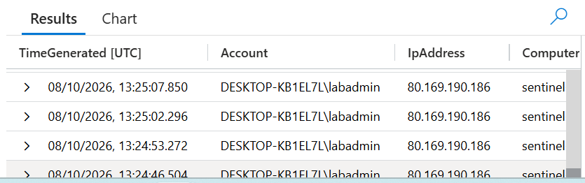
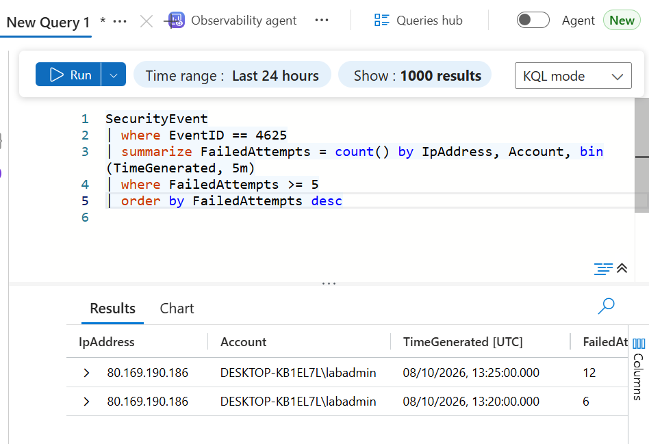
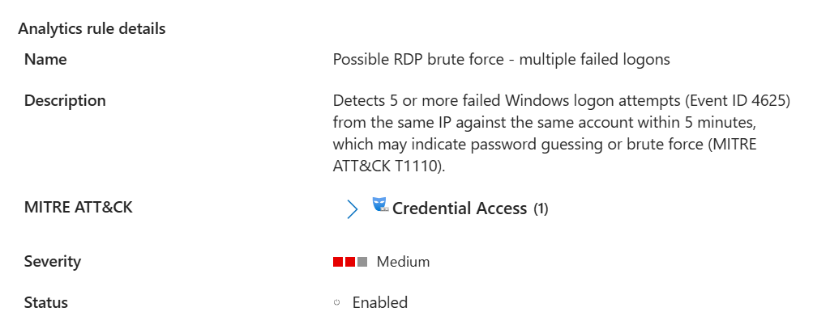
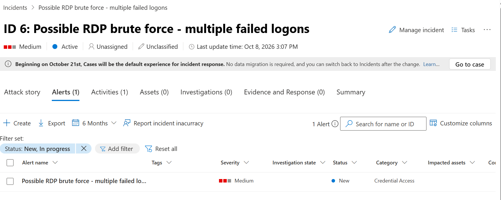
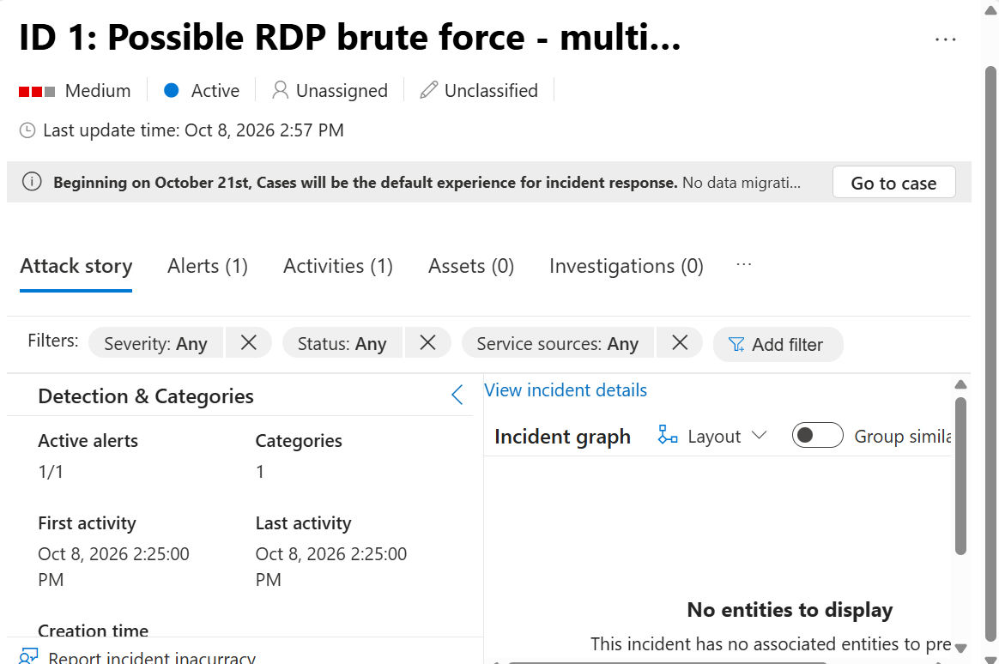

# Azure Sentinel Brute-Force Detection Lab

A small SOC-style project: I deployed a Windows VM in Azure, sent its Windows Security logs to Microsoft Sentinel, simulated a password-guessing attack against my own VM, and then investigated it with KQL, built a detection rule and triaged the resulting incident.

**Tools:** Microsoft Azure, Microsoft Sentinel, Log Analytics, Azure Monitor Agent (AMA), KQL, Windows Security Events, MITRE ATT&CK

---

## Objective

Show an end-to-end detection workflow:

1. Collect Windows Security Events into a SIEM
2. Investigate suspicious failed-login activity with KQL
3. Build a scheduled analytics rule that raises an incident
4. Map the activity to MITRE ATT&CK and document a response

> **Note:** All attack activity was simulated by me against my own VM, from my own IP address. No real systems or accounts were targeted.

---

## Architecture

```
Windows Server 2022 VM (sentinel-vm)
        |
        |  Windows Security Events
        v
Azure Monitor Agent (AMA) + Data Collection Rule
        |
        v
Log Analytics Workspace (sentinel-lab-ws)
        |
        v
Microsoft Sentinel
        |-- KQL investigation
        |-- Scheduled analytics rule
        '-- Incident / alert --> MITRE ATT&CK mapping
```

**Setup summary**

- Resource group `sentinel-lab` containing a Log Analytics workspace, Microsoft Sentinel and a Windows Server 2022 VM (Standard_B2ls_v2, France Central)
- RDP (port 3389) restricted to my own IP using a network security group rule
- Installed the **Windows Security Events** solution from the Sentinel Content hub and configured the **Windows Security Events via AMA** connector with a data collection rule collecting all security events from the VM
- Auto-shutdown enabled on the VM and a budget alert set to control cost

---

## Attack simulation

From my own computer I tried to connect to the VM over Remote Desktop with the account `labadmin` using an incorrect password repeatedly, then logged in once with the correct password. This generates the same log pattern a password-guessing attack would:

- **Event ID 4625** - an account failed to log on
- **Event ID 4624** - an account was successfully logged on

---

## Investigation (KQL)

### Query 1 - Failed logons

```kql
SecurityEvent
| where EventID == 4625
| project TimeGenerated, Account, IpAddress, Computer
| order by TimeGenerated desc
```



The query returned repeated failed logons against `labadmin` on the VM, all from a single source IP, within a few minutes.

### Query 2 - Possible brute force (5+ failures from one IP in 5 minutes)

```kql
SecurityEvent
| where EventID == 4625
| summarize FailedAttempts = count() by IpAddress, Account, bin(TimeGenerated, 5m)
| where FailedAttempts >= 5
| order by FailedAttempts desc
```



---

## Detection rule

I created a scheduled analytics rule in Microsoft Sentinel from Query 2.

| Setting | Value |
|---|---|
| Name | Possible RDP brute force - multiple failed logons |
| Severity | Medium |
| MITRE ATT&CK | Credential Access - T1110 (Brute Force) |
| Runs every | 5 minutes |
| Lookback | 1 day |
| Alert threshold | Greater than 0 results |
| Incident creation | Enabled |

**Rule logic**

```kql
SecurityEvent
| where EventID == 4625
| summarize FailedAttempts = count() by IpAddress, Account, bin(TimeGenerated, 5m)
| where FailedAttempts >= 5
```



---

## Alert and incident

The rule fired and Sentinel generated an incident in the Credential Access category.





---

## Findings

| Item | Detail |
|---|---|
| Activity | 18 failed logons (Event ID 4625) |
| Target account | `labadmin` on the VM |
| Source IP | My own home IP (80.169.190.xxx, partly redacted) |
| Timing | 12 failures in the 13:25 UTC window and 6 in the 13:20 UTC window |
| Pattern | Rapid repeated failures from one IP against one account, consistent with password guessing |
| Assessment | True positive for the detection, but a **simulated** attack that I carried out myself |

---

## MITRE ATT&CK mapping

| Tactic | Technique | ID |
|---|---|---|
| Credential Access | Brute Force | T1110 |

---

## Recommended response

If this had been a real attack, I would:

1. **Confirm the source** - check whether the IP is expected, and enrich it with threat intelligence
2. **Check for a successful logon** - look for Event ID 4624 from the same IP after the failures, which could indicate a compromise
3. **Contain** - block the source IP and disable or reset the targeted account if there is any sign of success
4. **Harden** - enforce an account lockout policy, require MFA, and stop exposing RDP to the internet (use Azure Bastion, a VPN or a just-in-time access rule)
5. **Monitor** - keep the detection rule enabled and review related alerts

---

## Lessons learned and improvements

- The rule's 1-day lookback with a 5-minute schedule kept re-detecting the same failed logons, which created **duplicate incidents**. In a real environment I would match the lookback to the schedule, or use alert grouping and suppression.
- The query did not map the account and IP as **entities**, so the incident graph was empty. Adding entity mapping would give richer incidents.
- Next steps: deploy the environment with **Terraform**, add a correlation rule for failures followed by a success, and add an automated playbook response.

---

## Clean-up

After finishing, I deleted the `sentinel-lab` resource group to remove all resources and avoid ongoing cost.
